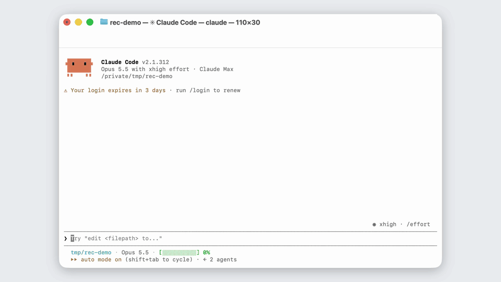
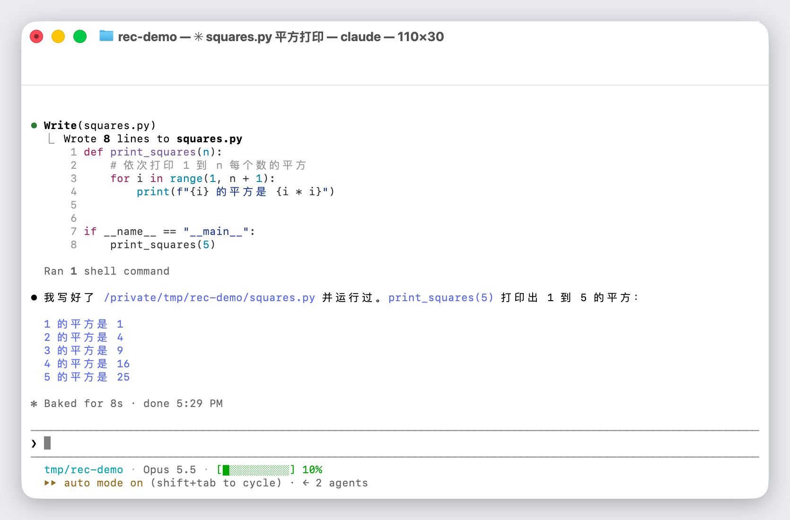

**English** | [中文文档](README.zh-CN.md)

# cyxj-agent-rec

> cyxj-agent-rec (command `rec`) is a background terminal recorder for AI coding agents on macOS: the agent opens its own terminal in a private tmux server, types, presses keys, reads the screen, and exports an MP4 that looks like a real Terminal.app window — without touching your keyboard, mouse or windows, so you keep using the computer while it records.

[](LICENSE)
[](#requirements)
[](#requirements)
[](https://www.youtube.com/@cyxj_ai)

**v0.1.0 · updated 2026-10-29 · tested on macOS 26.7.1, tmux 3.6a, asciinema 3.2.1, ffmpeg 8.1, Claude Code 2.1.312** · [Changelog](CHANGELOG.md)

<p align="center"></p>

<sub>Recorded by Claude Code itself with `rec start` → `rec type` → `rec wait --claude` → `rec export`, while the human kept working in other windows.</sub>

---

## What it does

Agents can already run commands, but they can't *film* them. Screen recorders need the window in front and take over the display; scripted recorders need the whole script written up front. `rec` gives the agent a terminal it can drive step by step and a camera that is always on:

- **Drive**: `rec type` types like a person (30 characters/s by default, Chinese and other CJK text included), `rec key` presses keys (`Enter`, `Down*3`, `S-Tab`, `C-c` …), `rec paste` sends multi-line text as a bracketed paste.
- **See**: `rec screen` prints the current screen as text; `rec shot` renders it as a PNG; `rec wait` blocks until text appears or disappears, the screen goes idle, or — with `--claude` — Claude Code asks a question or finishes its turn.
- **Record**: every byte is recorded by asciinema; `rec mark` drops chapter points.
- **Export**: `rec export` replays the recording and draws each frame with CoreText, Apple's own text engine (the one Terminal.app uses), then pipes raw pixels to ffmpeg. 4K by default, true color, no GIF step.
- **Stay out of the way**: everything runs in a separate tmux server (`tmux -L agent-rec`). No synthetic key events, no mouse moves, no window changes. Watch live with `rec attach <name>` (read-only) if you want.

<p align="center"></p>

## How it compares

| | macOS screen recording | [asciinema](https://asciinema.org) + GIF converter | [VHS](https://github.com/charmbracelet/vhs) | cyxj-agent-rec |
|---|---|---|---|---|
| Who drives the terminal | A person | A person | A `.tape` script written up front | The agent, step by step, reacting to what is on screen |
| Needs the window in front | Yes | Yes (it records your terminal) | No | No — private tmux server, nothing on your screen |
| Output | Real pixels | Text recording → GIF | GIF / MP4 / WebM | MP4 (4K default) + chapter list + PNG frames |
| Looks like Terminal.app | Yes (it is) | Its own renderer | Its own renderer | Yes — CoreText with Terminal.app's cell rules and window frame |
| Long waits | Edit by hand | Idle-time limit | Fixed by the script | Idle compression + spinner speed-up, logged so you can map back to the raw timeline |

## Requirements

- macOS (rendering uses CoreText through PyObjC; tested on macOS 26.7.1)
- Python 3.11+
- `tmux`, `asciinema`, `ffmpeg` — `brew install tmux asciinema ffmpeg`
- For `rec win` (GUI window recording): Swift toolchain (Xcode or Command Line Tools) and the Screen Recording permission for your terminal app
- The CLI's help text and messages are in Chinese; commands and flags are English

## Quick start

```sh
git clone https://github.com/chenyuxiaojin/cyxj-agent-rec.git
cd cyxj-agent-rec
uv venv .venv --python 3.13 && uv pip install --python .venv/bin/python -e .
ln -sf "$PWD/.venv/bin/rec" ~/.local/bin/rec        # or anywhere on your PATH
```

Install in editable mode (`-e`): `rec win` looks for its Swift helper at `capture/.build/release/rec-capture` inside the clone.

Record Claude Code doing a task:

```sh
rec start demo --cwd ~/code/demo -- claude
rec wait demo --claude                    # until it starts (or shows the trust-folder question)
rec key demo Down Enter                   # answer it
rec mark demo "prompt"                    # chapter point
rec type demo "write squares.py that prints 1..5 squared, then run it" --enter
rec wait demo --claude --timeout 600      # returns on a question, a confirm box, or 3 s of stillness; prints the screen
rec stop demo
rec export demo --from prompt --speedup -o ~/Movies/demo.mp4
```

Recordings and exports go to `~/.agent-rec/<name>/` (override with `AGENT_REC_HOME`).

## Commands

| Command | What it does |
|---|---|
| `start <name> [--size 140x34] [--cwd] [--env K=V] [--theme] -- <cmd>` | Open a background terminal and start recording |
| `type <name> "text" [--enter] [--cps 30] [--instant]` | Type text, character by character |
| `key <name> Enter Down Esc S-Tab C-c …` | Press keys; `Down*3` presses three times |
| `paste <name> "multi-line text"` / `--file` | Bracketed paste, so newlines don't submit |
| `screen <name> [--json] [--ansi]` | Print the screen as text |
| `wait <name> --until TEXT / --regex / --gone TEXT / --idle SEC / --claude [--timeout 300]` | Block until the condition holds; exit code 2 on timeout |
| `mark <name> "label"` | Add a chapter point |
| `stop <name>` | Stop and finalize the recording |
| `export <name or .cast> [--speedup] [--badge] [--fit 3840x2160] [--from/--to SEC or MARK]` | Render MP4 + `<name>.章节.txt` |
| `shot <name or .cast> [--at SEC]` | Render one frame as PNG |
| `attach <name>` | Watch from your own terminal (read-only) |
| `list` / `rm <name>` | List / delete sessions |
| `win list / shot / start` | Real-pixel recording of one window or app (see below) |
| `notify <event>` | Post a macOS distributed notification an app listens for |

## Export details

- **Matches Terminal.app.** Characters are drawn with CoreText using Terminal.app's cell rules for SF Mono 11 pt (7 pt advance, 14 pt line height, baseline 11 pt from the cell top, wide CJK glyphs left-aligned, font smoothing on). The window frame — title bar, traffic lights, rounded corners, folder icon, title format `dir — title — program — cols×rows` — is measured from macOS 26 Terminal.app. Against real screenshots the average per-pixel error on body text is under 0.2/255, about the noise level of the screenshot itself. `--no-frame` drops the window frame.
- **Programs behave as if they were in Terminal.app.** At session start `rec` tells the program the background is white (OSC 11), so Claude Code's auto theme picks light; it strips tmux traces (`TMUX`, `TERM_PROGRAM=tmux`) so Claude Code uses true color and its Terminal.app logo.
- **Idle compression** (on by default): any stretch where nothing on screen changes for more than 2 s is cut to 2 s.
- **Spinner speed-up** (`--speedup`): waits where only one to three lines change (spinner, timer) for more than 4 s play the first 1 s and last 0.5 s at normal speed and the middle at 8×, capped at 6 s. Typing and key presses are never sped up. `--badge` shows "▶▶ 8×" during sped-up parts.
- **Chapters**: `mark` points become MP4 chapters, plus a `<name>.章节.txt` with output times and which parts were compressed from which original times, so an editor can map back.
- **Re-render old recordings**: `rec export some.cast --theme terminal-dark`. Themes: `terminal` (Basic, light), `terminal-dark`, `monokai`.
- `rec shot` defaults to 22 px = 11 pt at Retina 2×, the same size as a real terminal screenshot.

## GUI windows: real-pixel recording (`rec win`)

For things that aren't a terminal — a menu-bar app, a desktop app, a browser — `rec win` records real pixels with ScreenCaptureKit, but only the window or app you name. Other windows never enter the frame; the mouse and focus are left alone.

```sh
cd capture && swift build -c release && cd ..   # once
rec win list                                    # windows on screen
rec win shot --app Chrome -o a.png              # one frame
rec win start web --app Chrome                  # record Chrome's largest window, even if covered
rec win start panel --app MyApp --desktop       # the app + wallpaper + menu bar, nothing else
rec mark web "step 1"; rec stop web; rec export web
```

- Output is converted to constant 30 fps (ScreenCaptureKit only emits frames when something changes) and padded to the moment of `rec stop`.
- Windows parked in the Stage Manager sidebar are captured at thumbnail size.
- UI that only appears on hover needs a switch in the app itself. `rec notify <event>` posts a distributed notification for that — e.g. [cyxj-notch](https://github.com/chenyuxiaojin/cyxj-notch) opens its panel on `com.xiaochen.notchdesk.open`.

## Source layout

```
agentrec/session.py   private tmux server + asciinema; type, keys, paste, screen, marks, stop
agentrec/term.py      terminal emulation (pyte) with dim support and private-sequence filtering; reads asciicast v2/v3
agentrec/render.py    CoreText cell renderer, themes, macOS 26 Terminal window frame
agentrec/export.py    replay → timeline (idle compression, speed-up) → frames → raw pixels to ffmpeg
agentrec/cli.py       command line
agentrec/window.py    rec win, calls the Swift helper
capture/              rec-capture: ScreenCaptureKit recorder (Swift)
tests/                unit tests
```

Tests: `.venv/bin/python -m unittest discover -s tests` (7 tests, all passing).

## FAQ

**How can an AI agent record a terminal demo video by itself?**
Give it `rec`. The agent runs `rec start` with any command (Claude Code, Codex, a shell), drives it with `rec type` / `rec key`, checks progress with `rec screen` or `rec wait`, and finishes with `rec stop` and `rec export`. Each step is a normal shell command, so any agent that can run commands can use it.

**How do I record Claude Code in the background on a Mac?**
`rec start demo -- claude`, then `rec wait demo --claude` after each prompt. `--claude` returns when Claude Code shows a selection or confirm prompt, or when the screen has been still for 3 seconds (its spinner and timer keep moving while it works).

**Is it a real screen recording?**
For terminals, no: it records the program's output and timing, then redraws every frame with Terminal.app's rules. The content is 100 % real; the pixels are a faithful re-render. That's why the window doesn't need to exist on screen. For GUI apps, `rec win` is a real-pixel recording.

**Will it type into my windows or move my mouse?**
No. Keystrokes go to the private tmux server only. `rec win` reads pixels through ScreenCaptureKit and never sends input.

**Does it work on Linux or Windows?**
No. Export depends on CoreText and `rec win` on ScreenCaptureKit, both macOS-only.

## For AI coding assistants

[`llms.txt`](llms.txt) lists the files worth reading, one line each. `rec -h` and `rec <command> -h` print every flag.

## About

Made by [@cyxj_ai](https://www.youtube.com/@cyxj_ai), a non-programmer building tools with Claude Code. More projects: [cyxj-notch](https://github.com/chenyuxiaojin/cyxj-notch) · [cyxj-groksearch](https://github.com/chenyuxiaojin/cyxj-groksearch) · [cyxj-hyperframes](https://github.com/chenyuxiaojin/cyxj-hyperframes)

## License

[MIT](LICENSE)
